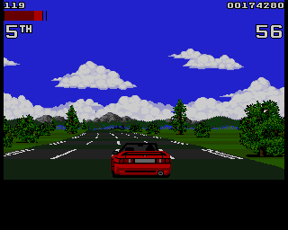

# PocketLotus2


 

PocketLotus2 brings the Acorn Archimedes version of **Lotus Turbo Challenge 2** (Krisalis Software, 1992) to the Analogue Pocket. It is a **static recompilation**: the original ARM program is translated to C and rebuilt for the RISC-V processor of [openfpgaOS](https://github.com/openfpgaOS/openfpgaSDK), with a small runtime standing in for the parts of RISC OS and the Archimedes hardware the game uses. It is packaged as a Pocket core that starts the game directly.

**No game content is included.** You build the core from your own copy of the original disks with one command; see [Building](#building) and [Game content](#game-content).

## Features

- The complete first-disk game: title sequence with music, car screens, options menu, races with engine and effects sound, game over and restart.
- Original speed: the game runs at its native 50 Hz, with music and sound mixed at 48 kHz.
- Two players on one Pocket with a second controller on the Dock, using the game's own split screen.
- Player names and the password entered with the d-pad.
- Raster colour changes timed as on the original hardware, so the road and horizon bands stay steady.
- High score table, player names, password and options menu settings kept on the SD card between sessions.
- **Two players on two Pockets over the link cable**, a mode the Archimedes original never had. Both consoles run the game in lockstep and exchange only controller input, and each shows its own car full screen.
- Translated code that matches the original program exactly. Over 40,000 frames of automated play the recompiled game produces the same machine state and sound as an ARM interpreter running the original code, frame for frame.

## Status

Version 1.0. It runs on the Analogue Pocket; name entry, saving and the race picture are confirmed on the device. Not yet tested: link-cable play between two real Pockets (it is tested between two desktop instances), the courses on the second disk, and two controllers on a Dock.

| Area | State |
| --- | --- |
| Loader decryption | Done statically; the protected disk sector is not needed |
| ARM to C recompiler | 18,818 game and 1,728 music instructions translated; matches the interpreter frame for frame |
| Pocket core | Runs on the device; about 1.4 M of the 2 M processor cycles per frame in a one-player race, about 1.6 M in linked play (SDK simulator estimate) |
| Input | Pad 1 is player 1 and pad 2 is player 2; two Pockets over the link cable |
| Audio | Original music module, run as recompiled code, plus race sound |

## Controls

| Pocket | Game |
| --- | --- |
| D-pad | Steer; move in menus |
| A or B | Fire / accelerate |
| R / L | Gear up / down (the default gearbox is manual) |
| X or Start | Skip the attract sequence |
| Select | Escape |

**Names and password:** moving onto a name box or the password box in the options menu opens it. Up and down change the letter at the cursor (a to z, then space), right accepts it and moves on, left deletes, and A or B closes the box. Holding up or down runs through the letters.

**Saving:** the high score table, both player names, the password and the options menu settings (gears, accelerate, control, number of players) are saved to the core's first save slot when they change and are restored at the next start. Saving is off in link cable play, where both consoles must start from the same state.

**Link cable play:** connect two Pockets. Hold **L** while starting the core on one Pocket (host, player 1) and **R** on the other (joins, player 2); each waits up to 30 seconds for the other. In the options menu the host chooses two players and starts the game. If the link drops, play continues alone.

## Building

You need your own copy of the Archimedes release, *Lotus Turbo Challenge 2 (1992) (Krisalis Software)*, as either:

- the two disk images F1023201 and F1023202 in JFD format (any file names), or
- the JASPP RISC OS package `Lotus-Turbo-Challenge-2_0-1.zip` or `_0-2.zip`.

Put them in a `Lotus` folder next to `build_core.py` (Git ignores that folder), or give their paths on the command line.

**Windows:** double-click `Build-PocketLotus2.cmd`, or run it from a command prompt with the same options as below. It installs MSYS2 through winget if it is missing, adds the C and RISC-V compilers and `make`, and runs the builder.

**Linux and macOS:** install a C compiler, `make`, and either a RISC-V toolchain (`riscv64-unknown-elf-gcc` or `riscv64-elf-gcc`) or Docker, then run:

```sh
python3 build_core.py                      # game files in ./Lotus
python3 build_core.py path/to/disks --sd /path/to/pocket-sd
```

The builder checks your files against the known release, decrypts and translates the program, builds the asset pack, downloads the openfpgaOS SDK at the tested commit and compiles the core. It compares each intermediate result with the tested build, so a finished run gives the same game. The result goes to `PocketLotus2-SD` (`--out` to change), and also onto the card with `--sd`. Copy its `Assets`, `Cores` and `Platforms` folders to the root of the Pocket's SD card. The core appears under the **openfpgaOS** category as **PocketLotus2**. A build takes about a minute once the tools are installed.

The [release](https://github.com/Buyukcaglar/PocketLotus2/releases/latest) has the source and a zip of the core's files that contain no game: the openfpgaOS core, the Pocket core and platform definitions and the platform art. The builder writes the same files along with the game, so the zip is not needed to build.

The individual steps, the PC runner, the verification runs and the test tools are in [docs/PORT_BUILD.md](docs/PORT_BUILD.md).

## How it works

- [docs/PORT_ARCHITECTURE.md](docs/PORT_ARCHITECTURE.md) explains the recompiler, the machine and RISC OS model, video, sound and the link protocol, and records what was learned about the game.
- [plan/ROADMAP.md](plan/ROADMAP.md) has the milestones and the current position.

| Path | Contents |
| --- | --- |
| `port/core` | Portable C runtime: ARM2 interpreter, machine model, RISC OS calls, runner for translated code, own-view drawing for linked play |
| `port/of` | openfpgaOS front end, link cable protocol, Pocket build script, desktop self-test, simulator profile |
| `port/host` | PC runner: dumps frames, sound and state hashes, scripted input, autopilot |
| `build_core.py`, `Build-PocketLotus2.cmd` | One-step builder from the user's game files, and its Windows launcher |
| `port/bench` | RISC-V instruction-count benchmark under QEMU |
| `tools/lotus` | Unpacker, recompiler, disassembler, asset packer, Pocket artwork converter and the recompiler maps the builder uses |
| `analysis` | Disk and package analysis scripts and their evidence (hashes and metadata only) |
| `docs`, `plan` | Documentation and planning |

## Game content

Lotus Turbo Challenge 2 is a commercial game, and its rights belong to their owners. This repository contains only original code, tools and documentation. Neither the repository nor any release contains the game program, its assets or anything derived from them. That covers the decrypted program, the generated C, the built `lotus2.elf` and the asset pack `lotus2.dat`. The exceptions are the images at the top of this page: the core's platform art, a greyscale image of the game's title logo that identifies the game in the Pocket's menu and is included in the release, and two screenshots of the game running. All of these are produced on your machine from your own disks, under `build/`, which Git ignores. Do not share a built core.

This project is not affiliated with or endorsed by the rights holders of Lotus Turbo Challenge 2, by Analogue or by the openfpgaOS project.

## Legacy hardware core route

Until November 2026 the project built an Archimedes chipset core (ARM26, MEMC, VIDC and IOC from Archie_MiSTer) in a Pocket APF shell. It reached a diagnostic bitstream that ran on a Pocket, but stopped before RISC OS booted. That work lives in `rtl`, `sim`, `quartus`, `apf`, `firmware`, the top-level `tools/*.py` scripts and the two manifests. [docs/ARCHITECTURE.md](docs/ARCHITECTURE.md), [docs/BUILD.md](docs/BUILD.md) and the other files in `plan` describe it. The recompilation route does not use any of it. It is kept for reference and is not maintained. Two vendored Amber wrappers without licence headers (`sram_byte_en.v`, `sram_line_en.v`) are not published, so that route does not build from this repository alone.

## Licence

The project's own code is licensed under the GNU General Public License v3.0 or later ([LICENSE](LICENSE)). Vendored third-party sources under `rtl/vendor` keep their own notices; see [LICENSES/README.md](LICENSES/README.md).

## Credits

- [openfpgaOS / openfpgaSDK](https://github.com/openfpgaOS/openfpgaSDK): the Pocket operating system, SDK, desktop shim and simulator this core builds on.
- [Capstone](https://www.capstone-engine.org/): disassembly in the analysis tools.
- Archie_MiSTer, Amber (Conor Santifort) and Stephen J. Leary's Archimedes chipset RTL: the legacy hardware route.
- Krisalis Software, for the original game.

Author: Buyukcaglar.
