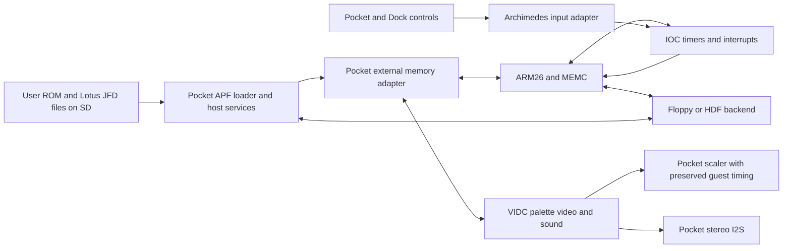

# PocketLotus standalone openFPGA core feasibility

> **Superseded on 22 November 2026.** This document belongs to the retired hardware chipset route. The project now recompiles the game for openfpgaOS; see the [roadmap](../plan/ROADMAP.md) and [port architecture](../docs/PORT_ARCHITECTURE.md). The media findings remain valid; the architecture recommendation does not.

The supplied Lotus Turbo Challenge 2 disks contain the Acorn Archimedes conversion, which runs ARM code under RISC OS. The recommended starting point is the maintained Archie_MiSTer chipset RTL inside a new Analogue Pocket APF shell. PocketRiscV is useful for Pocket interfaces and bring-up diagnostics; its RISC-V CPU cannot execute the supplied game directly.

The target is a standalone core launched from Analogue OS, as confirmed on 8 October 2026. It does not need to be an application for the separate openfpgaOS RISC-V runtime. The project is at the analysis stage: a playable Pocket build, FPGA fit, timing closure and Lotus runtime behavior remain to be demonstrated.

The subsequently supplied ZIP packages were also inspected recursively under `Apps/Games/!LOTUS`. They contain the same compiled ARM game and assets plus ADFFS launchers, with no rebuildable engine source. Version 0-3 is the preferred packaged runtime candidate; the earlier 0-2 launcher documents loader decryption and compatibility patches. See [ZIP source candidates](C:/Projects/PocketLotus/analysis/ZIP_SOURCE_CANDIDATES.md) for exact differences and comparisons to the original disks.

## Lotus media and machine requirements

Both original files in `C:/Projects/PocketLotus/Lotus` are gzip-compressed JFD preservation images. Decompression produces the `JFDI` signature, title and game ID 10232. Their ADFS E volumes are `Lotus2Dsk1` and `Lotus2Dsk2`, each describing an 819,200-byte disk with two heads and five 1,024-byte sectors per track.

| Input | Compressed bytes | Represented sectors | Recovered files | Unrepresented logical bytes |
| --- | ---: | ---: | ---: | ---: |
| F1023201.jfd | 599,729 | 759 | 100 | 41,984 |
| F1023202.jfd | 601,555 | 681 | 98 | 121,856 |

The original SHA-256 hashes are:

```text
F1023201  95b676b004f39cf0c896fe5ae1be80babbda8251d7cfb451946532e62b75915f
F1023202  76c0f90c0853b364877e82ae7205f6ca282c6922e4a1a7dfc597e3acca9a18ce
```

The filesystem maps, mirror maps, directory checksums and extracted file coverage passed the static checks. Recovered file bytes came from observed sectors without CRC errors. The original readme identifies the Archimedes conversion by Krisalis/Nigel Little; `!LOTUS.Loader` is an absolute ARM application, and the boot files use RISC OS modules and Obey commands. The `&FE4` type on some asset files is a RISC OS file type label and does not make them PC executables. Full metadata and hashes are in [the media inventory](C:/Projects/PocketLotus/analysis/media/inventory.json).

JASPP lists 1 MiB for the original game and RISC OS 3.11 or later. For a guest ADFFS loading route, provision 4 MiB of guest RAM because ADFFS has its own memory requirement. Pocket's physical RAM capacity is sufficient for that allocation; the external-memory adapter still has to deliver the required latency and DMA service. These published requirements are not a compatibility result for Archie on Pocket. [Lotus preservation record](https://forums.jaspp.org.uk/forum/viewtopic.php?f=25&t=226), [ADFFS release requirements](https://forums.jaspp.org.uk/forum/viewtopic.php?t=722).

### Protection prevents an ordinary ADF shortcut

Disk 1 contains a 1,024-byte sector at cylinder 79, head 1, sector ID 0 with JFD header `0xff020023`: double density with the data CRC-error flag set. Its payload SHA-256 is `cc5f88cc4299a01b77b790afbd5894815feeef9259806c5e62a0bfdc1c409369`. Disk 2 contains no CRC-error sectors. Neither file contains delta tables, DiscOp3 blocks or duplicate logical sectors; all timing bytes are 255, meaning unspecified.

The original hard-disk instructions require disk 1 for protection checks. JASPP's maintainer explicitly states that Lotus does not work as ordinary ADF and notes that XLock may check more than a bad CRC. Preserving the observed CRC error is therefore a minimum requirement, not proof that the entire protection system is reproduced. [Maintainer's explanation](https://forums.jaspp.org.uk/forum/viewtopic.php?t=502).

The generated `logical_zero_padded.adf` files are analysis views. They retain represented payloads, including the protection payload, but lose error behavior and JFD wrapper metadata and fill unrepresented space with zeros. They are not verified boot images. JFD records filing-system responses rather than a complete flux capture, so a future sector or track conversion must state what it reconstructs. [MAME JFD structure and loader](https://github.com/mamedev/mame/blob/master/src/lib/formats/jfd_dsk.cpp).

### Video and audio need original timing

The embedded ADFFS boot wrapper selects MODE 9 and reserves 80 KiB of screen memory. MODE 9 is 320 by 256 pixels, 16 logical colours, a standard 40 KiB framebuffer and nominally 50 Hz. The larger reservation suggests additional buffering but does not prove how the game uses it. [Original mode table](https://www.riscos.com/support/developers/prm/modes.html).

The original readme warns that ARM3 cache affects colour-split flicker. JASPP describes palette changes tied to VSync and IOC timer ticks, with sensitivity to unexpected refresh timing. Retain VIDC palette writes at their scanline positions and preserve guest timers and interrupts. A global palette sampled once per frame, cropping to 240 lines, or moving the guest to 60 Hz could change the game even if its title screen appears. Pocket presentation should scale the original display while preserving the guest's timing. [Maintainer's timing investigation](https://forums.jaspp.org.uk/forum/viewtopic.php?start=10&t=226).

The original `!LOTUS.!RUN` loads `MemMod`, `MusMod2`, `WimpBanner` and the protected `Loader`. The separate embedded ADFFS wrapper requests QTMTracker 1.43 and MusicModule2 0.02 and contains conditional compatibility patches. These are distinct boot routes. Native classic hardware can target the original loader; ADFFS is a candidate for using the supplied JFDs without first extending the FPGA floppy backend.

Music/jingle files and `SampleD` are present. Exact sample formats, DMA and interrupt sequences require tracing. Reuse Archimedes VIDC sound behavior and adapt its output to Pocket stereo I2S. Doom's OPL3 synthesizer does not reproduce this audio hardware.

## PocketRiscV source analysis

PocketRiscV was inspected at commit `88430e4d049e112413221433af12f3c0604f5470`. It is a small bare-metal RV32IM computer with a dashboard demonstration, not an Archimedes compatibility layer.

| Component | Active source configuration | Consequence for PocketLotus |
| --- | --- | --- |
| CPU | VexRiscv RV32IM, configured about 133.12 MHz | Replace with ARM26 hardware for the selected route |
| Firmware | 64 KiB BRAM for code, data and stack | Useful for diagnostics; not an Archimedes memory map |
| SDRAM | 64 MiB at `0x10000000` | Reference memory controller and host-transfer logic |
| PSRAM | 16 MiB CRAM0 at `0x30000000` | Latest source feature omitted from README memory table |
| Video | RGB565, 320 by 240, configured about 60 Hz | Does not match Lotus MODE 9 and raster timing |
| Terminal | 40 by 30 character overlay | Useful during hardware bring-up |
| Audio | I2S serial data forced to zero | Silence generator only |
| Assets and input | Empty data slots and controller definitions | No configured disk loader or playable control path |

The memory map and CPU clock are established by [cpu_system.v](https://github.com/thinkelastic/PocketRiscV/blob/88430e4d049e112413221433af12f3c0604f5470/src/fpga/core/cpu_system.v#L143-L157) and [core_top.v](https://github.com/thinkelastic/PocketRiscV/blob/88430e4d049e112413221433af12f3c0604f5470/src/fpga/core/core_top.v#L738-L765). The active timing has 400 by 512 total samples at about 12.288 MHz, giving approximately 60 Hz. These are configuration values, not measured hardware performance. [Video constants](https://github.com/thinkelastic/PocketRiscV/blob/88430e4d049e112413221433af12f3c0604f5470/src/fpga/core/core_top.v#L703-L710), [silence generator](https://github.com/thinkelastic/PocketRiscV/blob/88430e4d049e112413221433af12f3c0604f5470/src/fpga/core/core_top.v#L900-L939).

Useful pieces are the Pocket pin assignments, APF command handshake, bridge clock-domain examples, memory controllers, diagnostic display and package layout. They are references to adapt and verify, rather than a substitute for the Archimedes chipset.

Specific reuse concerns are recorded in [pocketriscv.json](C:/Projects/PocketLotus/analysis/pocketriscv.json):

- Use `src/fpga/ap_core.qsf`, which selects `5CEBA4F23C8` and `apf_top`. The root QSF is a different incomplete project with `DEVICE AUTO` and `ap_core`.
- Firmware is embedded through `core/firmware.mif`. Package instructions mention `firmware.bin`, but the active metadata declares no loader slot for it.
- CPU byte-write masks exist, but the external SDRAM and PSRAM adapters do not carry those masks through. Validate subword writes before reusing these adapters; a word-oriented stress demo cannot establish byte-store correctness.
- Generated VexRiscv RTL is present without a matching generator project. README's MIT statement and APF's separate agreement require component-specific provenance when copying files.

The current Windows PATH has Python and Git, but no Quartus, RISC-V compiler, Make, Icarus or Verilator commands were found. The WSL launcher reports that the subsystem is not installed. This was a PATH check, not an exhaustive software installation audit.

## Related repositories

PocketQuake and PocketDoom build available C engine source as native RISC-V firmware. Their game-data loaders cannot turn an ARM disk executable into a native program. DoomUltra64 is a native N64/libdragon port. The distinction matters because no Lotus source engine was found in these repositories. [Quake build source](https://github.com/thinkelastic/PocketQuake/blob/5792fe2a0dbc4af50dbf1b64cffa0c8e3bd3c902/src/firmware/Makefile#L36-L135), [Doom build flags](https://github.com/thinkelastic/PocketDoom/blob/11cfcf96813603244ad6394f9ddc7eee36e5d9cc/src/firmware/Makefile#L109-L125), [DoomUltra64 target](https://github.com/thinkelastic/DoomUltra64/blob/8a3d35ff44661a5f091fea9f7fc43d916db35b75/README.md#L3-L7).

| Repository and inspected commit | Useful references | Limits |
| --- | --- | --- |
| PocketQuake `5792fe2a0dbc4af50dbf1b64cffa0c8e3bd3c902` | PSRAM code loading, SDRAM data, DMA fill/copy, Pocket integration | Quake span, z-buffer and alias-transform accelerators are game-specific |
| PocketDoom `11cfcf96813603244ad6394f9ddc7eee36e5d9cc` | APF asset commands, input, indexed video, coherent swaps, audio DMA, separate settings/save storage | Indexed palette and Doom audio must not replace VIDC semantics |
| DoomUltra64 `8a3d35ff44661a5f091fea9f7fc43d916db35b75` | Example of adapting an engine renderer and validating a native port | N64 RDP/libdragon code provides no Pocket chipset implementation |

PocketDoom offers particularly useful [asset command helpers](https://github.com/thinkelastic/PocketDoom/blob/11cfcf96813603244ad6394f9ddc7eee36e5d9cc/src/firmware/dataslot.h#L1-L70) and an [audio DMA to I2S chain](https://github.com/thinkelastic/PocketDoom/blob/11cfcf96813603244ad6394f9ddc7eee36e5d9cc/src/fpga/core/core_top.v#L2235-L2301). These can guide the new host shell without importing its CPU, engine or synthesizer.

Build descriptions need source verification. Quake's active clock request is 105 MHz and its linker allocates 32 KiB BRAM, differing from README figures. Both Pocket game projects compile VexiiRiscv RTL while their ordinary generation scripts produce older VexRiscv. Quake requires an uninitialized Analogizer submodule. DoomUltra64 uses a floating libdragon container tag and an absent local libdragon source directory. Complete source pointers are in [reference findings](C:/Projects/PocketLotus/analysis/references/findings.json).

## Recommended Archimedes hardware baseline

Use [Archie_MiSTer](https://github.com/MiSTer-devel/Archie_MiSTer/tree/7edeed510dbb80f505c1126b3a19b9416783989a/rtl) at commit `7edeed510dbb80f505c1126b3a19b9416783989a` as the chipset baseline. Its RTL includes an Amber-derived ARM26 CPU, MEMC memory translation and DMA, VIDC video and sound, IOC timers/interrupts, floppy control and IDE support. Classic ARM's combined PC/status behavior needs preservation; a modern ARM core with an unrelated ABI is not sufficient.

Retain the machine RTL and replace MiSTer's HPS services and board shell with Pocket interfaces. Keep the [MiST predecessor](https://github.com/mist-devel/archimedes/tree/09ac3d0c68a16ef6524ad0a392e098bfe079fc89) as a reference for the smaller implementation and its CPU tests. Its Quartus project targets a Cyclone III EP3C25E144C8. That supports the plausibility of fitting an Archimedes design, but does not establish fit on Pocket's Cyclone V with APF and the new adapters. [MiST target](https://github.com/mist-devel/archimedes/blob/09ac3d0c68a16ef6524ad0a392e098bfe079fc89/fpga/mist/archimedes_mist.qsf#L39-L40).

Pocket has 64 MiB SDRAM and 32 MiB PSRAM. Start with 4 MiB guest RAM and a separately supplied suitable RISC OS ROM. Replace the board-specific PLL and memory interface while retaining CPU/VIDC/sound arbitration. Actual resource use, constrained timing and external-memory tests are required. [Pocket hardware](https://www.analogue.co/developer).



This is a proposed architecture. The two early technical risks are the Pocket memory/timing port and the JFD boot route.

### Choose and prove the JFD boot route

Archie's current floppy path synthesizes regular 1,024-byte sectors from block images; its README accepts 819,200-byte ADF. It has no native JFD parser. [Active floppy geometry](https://github.com/MiSTer-devel/Archie_MiSTer/blob/7edeed510dbb80f505c1126b3a19b9416783989a/rtl/fdc/fdc1772.sv#L104-L115).

The first candidate to evaluate is RISC OS 3.11 with ADFFS installed on a guest hard disk and the original JFD files passed intact. This follows JFD's intended loading model and could avoid a new protection-aware FPGA floppy backend. It requires guest compatibility, block/HDF services, boot selection and both-disk behavior to be proved. ADFFS is not automatically compatible with Archie merely because it works on an emulator.

The existing IDE podule embeds a 16 KiB RiscDev ROM. Either establish and provision that dependency separately or replace the IDE path with a documented alternative. The source checkout intentionally excludes the ROM. [IDE ROM dependency](https://github.com/MiSTer-devel/Archie_MiSTer/blob/7edeed510dbb80f505c1126b3a19b9416783989a/rtl/podule_ide.sv#L43-L44).

The alternative is a new JFD-aware read-only sector backend feeding the floppy controller, with an offline converter that retains explicit sector/error metadata. Keep the original native loader for this route and verify XLock operations, including CRC status, seek/read behavior and any additional expectations. Do not treat unknown sectors as known zero-filled originals or assume that the single identified error is the entire protection scheme.

Arculator is useful for tracing the original environment: its compatibility list names Lotus with HFE, while its direct JFD loader is marked incomplete and disabled. A desktop baseline should therefore use a verified protection-preserving format or guest ADFFS, rather than assume direct JFD support. Its source snapshot is pinned in [Archimedes findings](C:/Projects/PocketLotus/analysis/archimedes/findings.json).

## Implementation and acceptance gates

| Gate | Concrete work | Evidence required to pass |
| --- | --- | --- |
| 1 Source manifest | Select Archie chipset modules, APF shell and memory IP; record dependencies and licenses | Pinned, complete module list with ROM-dependent paths identified |
| 2 Pocket hardware | Build the actual `5CEBA4F23C8` target with real memory adapter and APF; use a ROM-free diagnostic target initially | Synthesis, fitter utilization, constrained timing, memory byte/word tests and DMA arbitration results |
| 3 Archimedes boot | Load a user-provided RISC OS 3.11 ROM; initialize 4 MiB RAM, IOC, keyboard and CMOS | Stable boot, correct timers/interrupts, video and sound; separate CMOS persistence |
| 4 Protected media | Prove ADFFS/HDF or the JFD-aware floppy backend using the exact input hashes | Both disks accessible, original protection behavior, boot route and disk changes verified |
| 5 Lotus play | Exercise title/demo, one-player races, graphics and sound, menus and disk transitions | Recorded Pocket observations, speed and audio/visual comparison; no promotion of boot success to full gameplay acceptance |
| 6 Distribution | Package core, source, build instructions and checksums; keep ROM/game input separate | Reproducible build and asset exclusion audit; clean install using user-provided files |

Use gamepad mapping to emulate the documented keyboard/joystick inputs, with separate boot/menu keys. Configure asset slots for ROM, both disks or an HDF, and separate nonvolatile CMOS/user storage. Gate CPU reset until required assets finish loading. Start with the original 320 by 256 guest display and measured 50 Hz behavior; qualify Pocket/Dock scaling without altering guest timing. Defer accelerators and presentation changes until profiling identifies a real need.

A software ARM emulator on RISC-V is a fallback if the hardware port encounters an unresolved constraint. ArcEm has a portable C ARM26 interpreter, but needs Pocket platform backends, disk handling and measured speed. A reconstructed native Lotus source port would require a separate reverse-engineering project. Neither route inherits Quake/Doom's native performance merely by using the same CPU.

## Source reuse and project artifacts

Preserve file-level notices. Archie uses LGPL-2.1-or-later for Amber, BSD-style terms for major chipset modules, GPL-3.0-or-later for the Archimedes top/FDC/IDE podule, and GPL-2.0-or-later for the MiSTer wrapper. Its README summary is not a blanket license for the tree. Pocket references also include APF's Analogue agreement and imported game-engine licenses. ADFFS and embedded ROM redistribution terms were not established; keep separately supplied components outside the public source and core kit.

The local analysis extracted game content into `analysis/media/F1023201` and `F1023202`. Those directories, `Lotus`, reference checkouts, ROMs and generated outputs are excluded by the project `.gitignore`. No root Git repository or release was created.

The durable artifacts are:

- [Media evidence](C:/Projects/PocketLotus/analysis/media/evidence.json), [inventory](C:/Projects/PocketLotus/analysis/media/inventory.json) and [reproducible parser](C:/Projects/PocketLotus/analysis/media/inspect_media.py).
- [PocketRiscV findings](C:/Projects/PocketLotus/analysis/pocketriscv.json), [Quake and Doom comparison](C:/Projects/PocketLotus/analysis/references/findings.json) and [Archimedes route findings](C:/Projects/PocketLotus/analysis/archimedes/findings.json).
- [Reference lock](C:/Projects/PocketLotus/analysis/reference-lock.json) and [verification result](C:/Projects/PocketLotus/analysis/verification.json).

Recheck hashes, checkout pins and JSON syntax with `python C:/Projects/PocketLotus/tools/verify_analysis.py`. This check passed for the originals and all materialized reference source trees. It checks byte preservation and evidence consistency only. No firmware compilation, HDL simulation, synthesis, emulator launch or Pocket game execution was performed.

An unused no-checkout `Archimedes_MiST` clone points to `mist-devel/mist-board`; the actual MiST source is `Archimedes_MiSTCore`. Automatic approval review rejected removing the unused clone as “blocked by policy,” so it remains recorded in the reference lock and is not used as the hardware baseline.
