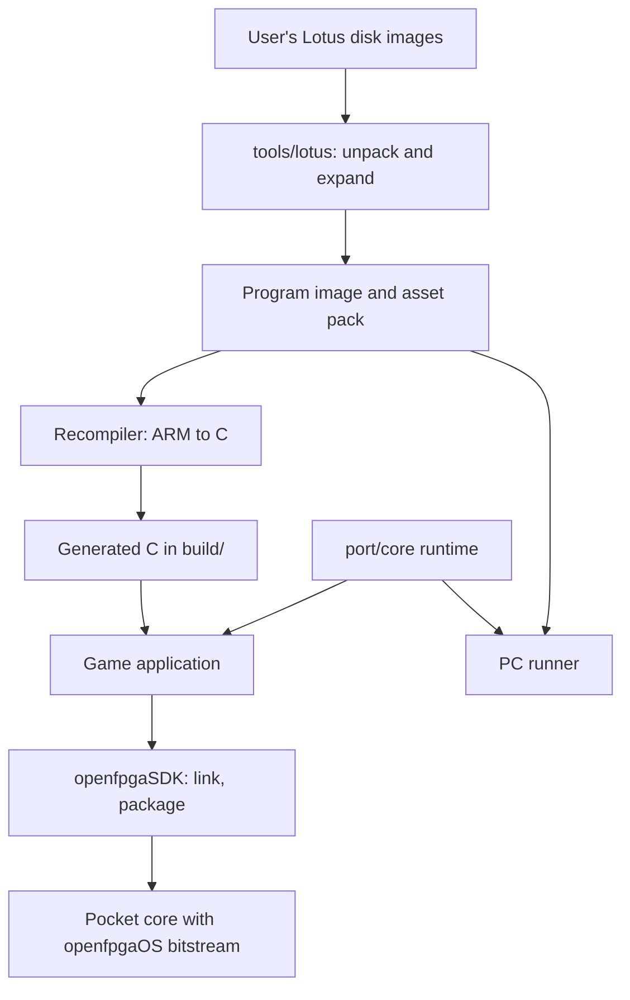

# Port architecture

This describes the recompilation route adopted on 22 November 2026. It replaces the hardware chipset design in [ARCHITECTURE.md](ARCHITECTURE.md).

## Goal

A Pocket core that runs Lotus Turbo Challenge 2. The core is the stock openfpgaOS bitstream and kernel from [openfpgaSDK](https://github.com/openfpgaOS/openfpgaSDK) (VexiiRiscv rv32imafc at 100 MHz, 64 MiB SDRAM) with one application: the game's own ARM code translated to C, linked against a runtime that stands in for the parts of RISC OS and the Archimedes that the game touches. No FPGA logic is written for this route.

## Why recompile

The game executes about 86,000 ARM instructions per 50 Hz frame, measured over the first 2,000 frames in the reference harness, which is about 4.3 million per second. An interpreter on the 100 MHz RISC-V would have roughly 23 host cycles per guest instruction, which is not enough. Translated C needs only a few host instructions per guest instruction and leaves room for video conversion and audio.

The interpreter still matters: it is the reference that translated code is checked against, and the fallback for any code the translator has not covered.

## What the game is

Findings from unpacking and running the program. Addresses are Archimedes logical addresses.

| Item | Finding |
| --- | --- |
| `Loader` | X Lock protection, three XOR layers. Decrypted statically by `tools/lotus/unpack.py`. The key byte it reads from the protected sector is also stored in the loader, so the disk image is not needed |
| `Logo` | Not a picture: the encrypted start-up stub, loaded at `&70000`. Shows the Krisalis screen, expands the main program and jumps to `&8000` |
| `Graphics` | Not a picture: the encrypted, compressed main program, about 47 KiB packed, expanded to `&8000` upward |
| Code style | Machine-converted 68000 code. Calls are `STMDB sp!,{pc}` followed by a branch, relying on the ARM2 stored PC being 12 bytes ahead. Constants follow branches inline. Jump tables use `LDR pc,[lr]` |
| Processor modes | Starts in user mode, calls `OS_EnterOS`, then runs in supervisor mode |
| Interrupts | Replaces the hardware IRQ vector at `&18` with its own handler, masks every IOC interrupt and enables only Timer 1. The start-up stub uses the VSync event through `EventV` |
| Video | MODE 13 (320x256, 256 colours) for pictures, MODE 9 (320x256, 16 colours) for the game, two screen banks switched with `OS_Word 22`, palette through `VDU 19` and `OS_Word 12` |
| Files | `OS_File` whole-file loads by name from `<Lotu$Dir>.Disk1` and `.Disk2`. No raw sector access after the loader |
| Music | `MusicModule2` (SWI chunk `&41C40`), a Krisalis tracker module that the game feeds from files such as `bootup` and `jingle1` |
| Sound effects | RISC OS sound system with the game's own channel handler at `&11B30`, four channels, samples from `SampleD` |
| Input | Probes three joystick interfaces (`Joystick_Read` and two third-party ones) and reads the keyboard through `OS_Byte` |

During a race the game installs a second IRQ handler at `&DEA0` that handles VSync and Timer 1 and writes VIDC directly, then chains to the previous handler through a relocated copy of the old vector instruction at `&DF54`. Over 6,000 frames that word is the only instruction rewritten at run time.

`MusicModule2` does not touch the hardware. It configures the sound system for one channel at a 48 µs sample period (20.8 kHz), installs its own channel handler, and runs its sequencer from that handler every second buffer, which makes the music tempo 50 ticks per second of sound time. The game replaces the handler with its own four-channel one for the race.

During the race the game shifts the picture by 4 bits for smooth horizontal scrolling and then clears the leftmost word (8 pixels) of each of the 200 race-view lines every frame (`&16E64`). It does not move the VIDC display window, so the 8-pixel black strip at the left edge is the game's own masking of the scroll seam, not a port fault. The renderer moves the race picture 4 pixels left so that the strip is split between both edges. The Pocket shows the framebuffer 2 pixels further right than it is written, so the Pocket build moves the race picture 2 more (`display_shift`).

Keyboard: the game polls RISC OS internal key numbers with `OS_Byte 121`. Player 1 is up 51, down 50, left 97, right 66, fire 5 (left Alt); player 2 is up 88, down 79, left 102, right 103, fire 8 (right Alt); 112 is Escape and 113 (F1) skips the attract sequence. Fire accelerates; with the default manual gearbox, up changes up a gear. The car's lateral position in the race is the word at `&1D368`.

## Components

### Runtime (`port/core`)

Portable C with no operating system dependencies, shared by the PC runner and the Pocket application.

- `arm26.c` is the ARM2 interpreter with 26-bit semantics: PSR in R15, banked registers, the PC+12 store rule, `TEQP`, `LDM` with the S bit.
- `machine.c` holds guest memory as a flat 32 MiB array, the IOC timers and interrupt registers, VIDC palette, and the scheduler. Time advances in 8 MHz CPU cycles, 512 per scanline and 312 lines per frame, and slices end at timer expiry so interrupts arrive at the right cycle. The palette is recorded once per scanline, 64 cycles into the line, so that mid-frame palette changes survive to the display. Two corrections keep the race's raster bands where an ARM2 would put them, since translated code takes an interrupt only at a block boundary, up to a few hundred cycles late: a Timer 1 restart written in an interrupt handler is timed from when the interrupt was raised, and palette writes in a handler count from that moment too, correcting lines already recorded. Without them the road stripe bands moved by a line from frame to frame (a flickering row of white dots at the horizon, and alternating lines on the night course).
- `sound.c` is the sound system below the game: `Sound_Configure` and `Sound_Stereo`, the buffer interrupt every `samples x period` of guest time, the call into the channel handler with the RISC OS register interface, and conversion of the 8-bit VIDC logarithmic samples to linear stereo. It also loads the game's own `MusicModule2` and passes the `Mus_*` SWIs to it, so the music is the original player code, recompiled with the rest. `sound_read` resamples to the host rate.
- `riscos.c` implements the RISC OS calls the game makes. Calls with the X bit that are not implemented return an error, which is how the game's own probing expects a missing module to behave. Other unknown calls stop the run so that nothing is silently ignored.

Guest memory map used by the runtime:

| Range | Use |
| --- | --- |
| `&0000018` | IRQ vector; initially a branch to a trap that runs the built-in OS handler |
| `&0008000`–`&008F000` | Application space (the original 540 KiB slot) |
| `&1800000` | Module area. `MusicModule2` claims its song buffer here; the game loads songs 4 bytes below the address `Mus_Bufferaddress` returns, and loads the race samples (`sampled`) into the same space |
| `&19FFFF0` | `MusicModule2` private word |
| `&1A00000` | `MusicModule2` image, loaded from the game directory and run as guest code |
| `&1F00000` | Trap words, sound buffers (`&1F01000`, `&1F02000`), log tables and channel control blocks |
| `&1C00000` | IRQ and supervisor stacks |
| `&1FEC000`–`&2000000` | Screen memory, 80 KiB |
| `&3200000`, `&3400000`, `&3600000` | IOC, VIDC, MEMC registers |

### Recompiler (`tools/lotus/recomp.py`, `port/core/hybrid.c`, `port/core/recomp_rt.h`)

Translates the expanded game image and the music module to C, as two regions with their own chunk tables and leader maps.

- **Discovery.** Seeds are the words the interpreter executed (coverage from the analysis build of the PC runner). Static descent follows branches, fall-through and the `STMDB sp!,{pc}` return addresses from there. The current run gives 18,296 instruction words, of which 12,993 were executed in the reference run. Words that were both written and executed at run time are never translated.
- **Blocks.** A leader is a branch target, a return address, the instruction after a SWI, any code address that appears as a literal in the image, the first word of a chunk, or an address reported by a previous run. Slices of CPU time may end only at a leader.
- **Chunks.** Code is grouped by 4 KiB of guest address into one C function each. Inside a chunk, guest registers and the four flags are C locals; direct branches are `goto`; indirect jumps go through a `switch` on the guest PC. Leaving a chunk writes the locals back to the CPU structure. Guest memory stays live, so inline constants and variables stored next to code keep working.
- **Fallbacks.** Instructions that change mode or use rare forms call the interpreter for that single instruction (10 of 18,296 today). An indirect jump to an address that is not a leader is interpreted until a leader is reached, and its entry address is written to `leaders_seen.txt`, which the next recompile merges in. After three rounds the only remaining fallback is the patched word at `&DF54`.
- **Equivalence.** Each translated instruction charges the same cycles as the interpreter. The interpreter can run with the same leader map (`--engine reference`), so both engines stop at the same places. The PC runner hashes CPU state, application memory, screen memory and per-line palettes every frame; the two engines give identical hashes for 6,000 frames.

- **Wait loops.** A loop that only reads memory and compares until an interrupt handler changes something (seven of them, such as the vertical-blank wait at `&D744`) is recognised at translation time. When one pass has run without touching hardware, every further pass is identical, so the generated code charges all the passes that fit in the time slice at once. The interpreter arrives at the same cycle count one pass at a time, so the hash comparison still holds.

Writes into translated code are not detected at run time. The analysis build reports them instead, and that report has to be repeated on every new scripted run.

On the development PC 6,000 frames take 0.44 s translated and 5.8 s interpreted. Pocket speed is not measured yet.

### Pocket application (`port/of`)

An openfpgaSDK application that links the runtime and the generated C. It builds into a custom core, runs in the SDK desktop shim and runs the scripted session to the end in the SDK's os25 simulator (`tools/qsim`); it has not been run on a Pocket. Mapping:

| Game side | openfpgaOS side |
| --- | --- |
| MODE 9 and MODE 13 screen memory | `of_video_set_mode` with a 320x256 source framebuffer, scaled to the 320x240 panel; 50 Hz vertical timing |
| Per-scanline palette | Every frame is converted to RGB565 with the palette captured for each line; the race changes palette on about 19 lines per frame, so an indexed mode cannot be used |
| `OS_File` loads | One asset pack (`lotus2.dat`, data slot 4) read into memory at start, built by `tools/lotus/pack.py` |
| Joystick and keys | Pad 1 drives player 1's keys and joystick 0 of `Joystick_Read`: D-pad, A or B fire (accelerate), R and L gear up and down, X or Start skip, Select Escape. Pad 2 (dock) drives player 2's keys and joystick 1 |
| Name and password boxes | The game's editor (&F60C) reads one key at a time with a timed `OS_Byte 129` and accepts a to z, space, Delete and Return. `riscos.c` turns the pad into those keys: up and down replace the letter at the cursor (Delete, then the next letter), right accepts, left deletes, fire is Return. The pad is read once a frame and presses wait until the editor asks, because the game redraws the box after each letter |
| Saves | `save.c` copies the high score table (text at &2B0AB), the two player names and the password (&2B425) and the options (gears, accelerate, control, players at &2B33C) to a 348-byte block. The front end writes it to `lotus2_0.sav` when it changes and applies it after the program's start-up code (&128D8) has set its defaults, with the control flags the game derives from the options (&1D6AC). Off in linked play |
| Channel handler output and music | Mixed to stereo in `sound.c` (channels averaged, as VIDC time-multiplexes them, so it cannot clip), resampled to 48 kHz. The front end keeps about 60 ms queued and varies the output rate by at most 1 % to hold that level, so late frames do not empty the output |
| Picture timing | Each line's screen bytes are copied as the line is displayed. The race swaps banks at vertical sync and starts drawing the next frame during the blank lines, so screen memory at the end of a frame is not what was shown (this caused flicker of every other frame on the first Pocket run) |
| Two consoles (link cable) | Lockstep over `of_net`: each console sends its pad state 3 frames ahead and runs a frame when both inputs are known; the host is player 1, the joining console player 2, using the game's own two-player mode. Each console shows its own player full screen: `port/core/view.c` hooks the race frame routine (SWIs at &16D74, &16DD4, &16E40, &16E4C, also patched into the translated program by `recomp.py`). It draws only that player's view at the one-player height of 200 lines: view height ip+&E0, the depth-to-line table at &29738, player 2's screen offset of &4100 and the raster palette list built from ip+&1C0/&1C4 and &2A020/&2A070. Logic stays in two-player mode on both consoles. Drawing is taken out of emulated time and replaced by a fixed 200,000-cycle spin, the measured average of the original two-view drawing, so both consoles reach every VSync (where the game samples the keys) at the same point. Every 250 frames both compare a hash of the program counter and application memory less the drawing scratch listed in `view.c`. `port/of/link.c`; on the desktop the same protocol runs over TCP on localhost. `lotus_host --view 1|2` draws one console's view, and `--view 3` keeps the timing but draws both views, as a reference; `--lockstep-hash` writes the link hash for every frame |
| 50 Hz frame and IOC timer | Scheduler driven by guest cycles. The program asks for 50 Hz display timing and times a few flips: when the display really runs at 50 Hz the flip paces the game, otherwise a 20 ms clock does, so speed and music tempo are right on any display |

### PC runner (`port/host`)

Headless. Loads the unpacked images, runs a number of frames and writes frames as PPM and sound as WAV (`--wav`). Input comes from a timed script (`--input`) or an autopilot (`--autodrive`) that holds the accelerator, changes up and steers by the car's lateral position, which is enough to finish races and reach game over unattended. It is the place where behaviour is established before anything is moved to the Pocket.

## Game content boundary

Decrypted images, expanded code, generated C, the asset pack and any ELF containing translated game code are derived from the user's disks. They are produced under `build/` on the user's machine and are never part of published source or a release. A release contains tools, runtime and build instructions.
